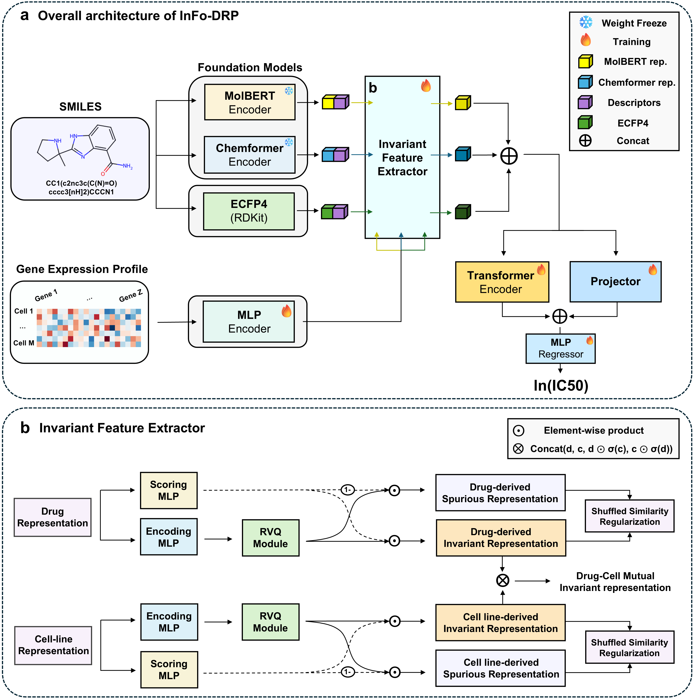

# InFo-DRP

**InFo-DRP: Integrating Invariant Learning and Foundation Representations for Unseen Drug Response Prediction**
([Paper](https://doi.org/10.1109/JBHI.2026.3738922), [Supplementary Information](Supplementary_Information.pdf))

InFo-DRP is a drug response prediction framework designed for robustness under chemical distribution shift by coupling invariant learning with foundation-model drug representations.

---

## Repository structure

```
InFo-DRP/
├── src/            # model, training and evaluation
├── preprocess/     # drug and cell line feature extraction
├── data/           # processed features and data splits (GDSCv1, GDSCv2, CCLE)
├── scripts/        # evaluation of the trained checkpoints
├── checkpoint/     # trained checkpoints (download from Google Drive)
└── pretrained/     # pre-trained MolBERT / Chemformer weights (download separately)
```

Split directories: `db` = drug-blind (`newDRUG`), `cb` = cell-blind (`newCELL`), `sb` = scaffold-blind (`newSCAFFOLD`), `mix` = random split (`newPAIR`).

---

## Installation

```bash
conda env create -f environment.yml
conda activate infodrp
```

---

## Checkpoints

Download the trained checkpoints from [Google Drive](https://drive.google.com/drive/folders/1vgMqlhE6ESjkY5z__WGehO2IA-yQzqsS?usp=sharing) and place them under `checkpoint/` (e.g., `checkpoint/gdscv2_newSCAFFOLD/fold0_best.pt`).

Evaluate a setting:

```bash
python src/main.py --dataset gdscv2 --split_mode newSCAFFOLD --eval_only --ckpt_dir checkpoint/gdscv2_newSCAFFOLD
```

or all settings with `bash scripts/evaluate_all.sh`.

---

## Training

```bash
python src/main.py --dataset gdscv1 --split_mode newDRUG
python src/main.py --dataset gdscv2 --split_mode newSCAFFOLD
python src/main.py --dataset ccle   --split_mode newSCAFFOLD
```

Available settings: `gdscv1` (`newDRUG`, `newCELL`, `newPAIR`), `gdscv2` (`newSCAFFOLD`, `newDRUG`, `newCELL`), and `ccle` (`newSCAFFOLD`). Checkpoints are saved to `checkpoint/` and test predictions to `result/`. Run `python src/main.py --help` for all options.

---

## Feature extraction

Drug features (MolBERT, Chemformer, ECFP4, and physicochemical descriptors) from a CSV with `PubChemID` and `SMILES` columns:

```bash
python preprocess/drug_features.py --input my_drugs.csv --out_dir my_features --prefix my_drugs
```

This requires the pre-trained weights released by [MolBERT](https://github.com/BenevolentAI/MolBERT) (`molbert_100epochs`) and [Chemformer](https://github.com/MolecularAI/Chemformer) (`combined_large`). Download them from the respective repositories and place them as follows (or set the paths with `--molbert_ckpt` and `--chemformer_ckpt`):

```
pretrained/
├── molbert_100epochs/          # hparams.yaml, checkpoints/last.ckpt
└── chemformer/
    └── combined_large.ckpt
```

Cell line features are computed with `preprocess/cell_features.py`. The processed features in `data/` were generated with these scripts.

---

## License

This project is released under the [MIT License](LICENSE).

---

## Citation

```bibtex
@article{lee2026info,
  title={InFo-DRP: Integrating Invariant Learning and Foundation Representations for Unseen Drug Response Prediction},
  author={Lee, Jisang and Yeom, Taelim and Kim, June-Woo and Lee, Hyunju},
  journal={IEEE Journal of Biomedical and Health Informatics},
  year={2026},
  publisher={IEEE}
}
```
